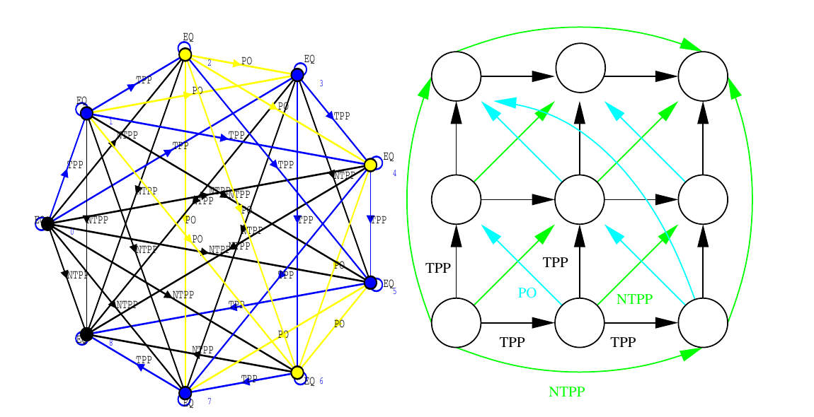
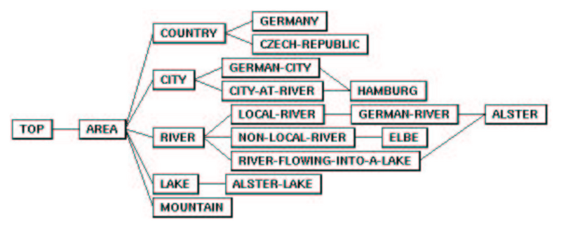
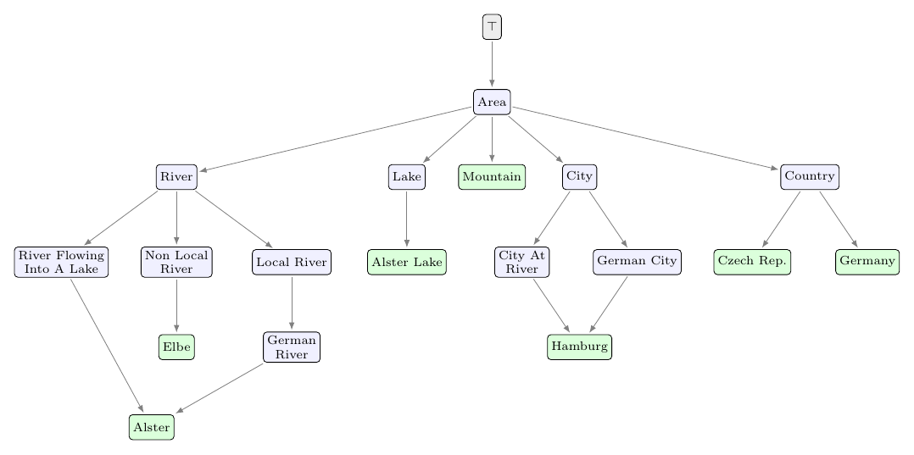

# ALCI_RCC5 Decidability — an AI-assisted attack on a 20-year-old open problem

Is concept satisfiability in **ALCI_RCC5** (the description logic *ALCI* with
the RCC5 spatial relations as roles, under abstract composition-table
semantics) decidable? The question has been open since Wessel's 2002/2003
work ([report7.pdf](papers/report7.pdf); the family is defined and the open
problem stated there, alongside the earlier
[report4](papers/report4.pdf)–[report6](papers/report6.pdf)). This
repository documents a sustained, adversarially-reviewed attack on it,
conducted by AI assistants under human direction. The full question is
**still open**, and the attack on it is machine-checked only in part. **One
_sub_-question is settled outright: for the ∀PO-free fragment there is now a
decision procedure the Lean kernel checks end to end** — written up on its own in
[**`papers/pofree_fragment_arxiv.pdf`**](papers/pofree_fragment_arxiv.pdf).

<p align="center">
  
</p>

<p align="center"><em>Wessel's 2002/2003 construction of an RCC8 network isomorphic to an n×n grid (<a href="papers/report7.pdf">report7</a>, Fig. 10) — found by a Lisp enumerator program and rendered with CLIM (MCL), not drawn by hand. Such grid models <strong>exist</strong> — yet no concept term is known that <strong>forces</strong> one. That gap (the "coincidence obstruction") is exactly why the problem has resisted both a decidability and an undecidability proof for two decades.</em></p>

> **Disclaimer.** The papers and code here were produced by AI assistants
> (Claude Opus 4.6/4.7/4.8, Claude Fable 5, Claude Opus 5 and, for the
> 2026-11-11 work, Claude Fable 5.2 / Anthropic; GPT-5.4, GPT-5.4 Pro, GPT-5.5,
> GPT-5.6 Pro, GPT-5.6 Sol and Astra 6 / OpenAI),
> prompted and directed by Michael Wessel. They have **not** been peer-reviewed or verified by
> human domain experts, and are offered as a **discussion piece**. Standing
> label for the **full logic**: **strongly supported, not certified**. The
> **∀PO-free fragment** is a machine-certified exception — see the status
> section — as are the RCC5 normal form, the soundness pipeline, and the
> abstraction's faithfulness.

## Read this first: the paper

**Everything of substance is in the overview paper** —
[**PDF**](papers/overview_arxiv.pdf) · [source](papers/overview_arxiv.tex).
It is self-contained: the history (Cohn 1993, Wessel 2002/2003, Lutz &
Wolter 2006), why every known undecidability reduction fails, why concrete
domains do not settle it, the approaches tried route by route, the
machine-checked conditional reduction together with the steps of it that are
only argued, the decidable fragment, the reasoners, and an honest account of the
AI-assisted methodology.

**Want only the finished result?** The ∀PO-free fragment has a focused,
self-contained paper —
[**`papers/pofree_fragment_arxiv.pdf`**](papers/pofree_fragment_arxiv.pdf) ·
[source](papers/pofree_fragment_arxiv.tex): the ordered-disjoint normal form, the
cone scheme, both correctness directions, the split-forest shape of the models it
builds, the Lean formalization, and its provenance. The split into two papers follows the recommendation of a cold review
by GPT-5.6 Sol (September 2026), archived with its own draft of such a paper in
[`papers/gpt-5.6-latest-overview-paper-review-and-recommendation/`](papers/gpt-5.6-latest-overview-paper-review-and-recommendation/);
the paper here was written afresh from the Lean artifact.

**Prefer slides?** A talk version of the same material is in
[**`papers/talk_ALCIRCC5.pdf`**](papers/talk_ALCIRCC5.pdf) ·
[source](papers/talk_ALCIRCC5.tex) — a ~40-minute deck covering the problem,
why it is hard (the two axes and the coincidence obstruction), the routes
tried, what is certified, the $\Pi^0_1$ observation, the reasoner, and the
lessons on working with frontier AI.

**Want the positive result explained?** The project's strongest
unconditional theorem — decidability of the **∀PO-free fragment** — has a
dedicated explainer:
[**`papers/why_po_free_decidable.pdf`**](papers/why_po_free_decidable.pdf) ·
[TeX](papers/why_po_free_decidable.tex) ·
[Markdown pointer](papers/WHY_PO_FREE_IS_DECIDABLE.md). It is the technical sibling
of the non-technical
[`WHY_ITS_HARD.md`](WHY_ITS_HARD.md): written
for a reader who knows description logics, tableaux, and blocking (but not
automata or model theory), it explains the finite-certificate architecture,
the handful of composition-table facts everything rides on (four
deterministic cells; PO forced by no single step yet available wherever
anything is), and **both independent proof routes** — the two-tier quotient
(chain-and-phase) and the ordered-disjoint normal form (structural) —
at "yes, I believe that" depth rather than full-proof depth, with an
honest per-claim status table (what is Lean-certified vs. machine-checked
vs. theorem-level).

The rest of this README is just a map. To avoid duplicated, drifting prose,
the detailed narrative lives in **one** place — the paper — with the full
dated audit trail in [CONVERSATION.md](CONVERSATION.md), the Lean history in
[LEAN.md](LEAN.md), and the superseded threads in [OUTDATED.md](OUTDATED.md).

## Status

**Where things stand (2026-11-11).** Decidability of **full** ALCI_RCC5 (and
ALCI_RCC8) **remains open**. The **∀PO-free fragment is decided**, by a decision
procedure checked end to end in Lean with fragment membership as its only
hypothesis, and written up on its own in
[`papers/pofree_fragment_arxiv.pdf`](papers/pofree_fragment_arxiv.pdf). Also
machine-checked: the RCC5 normal form in both directions and, for the full logic,
a *conditional* reduction — if a fixed, verified checker is complete for some
computable list of candidate certificates, satisfiability is decidable — whose
premise is open; the route to it through a width property, **F6**, is argued but
not proved. SAT is Π⁰₁ (Lutz & Wolter 2006, Thm 28), so for that route
*qualitative* F6 would suffice: some finite certificate for each satisfiable
concept, with no computable bound. The full-logic line of attack has been paused since July
2026; what a future attack needs is recorded in the overview's conclusion and in
[`papers/cold_review_f6_w2prime/`](papers/cold_review_f6_w2prime/). A 2026-10-08
harvest from the 22nd review extended the decided fragment to a slice
*containing* `∀PO` (the PO-erasure fragment 𝒟, Lean-certified).
**2026-11-11 (unreviewed):** the full logic is shown to contain the unary case
of an open problem of two-variable logic; the cover-tree tableau is found
incomplete; a cited theorem about two-variable logic turned out to have been
withdrawn; and the documents were re-synced the same day, which turned up a
third erratum. See the first entry below and [`ERRATA.md`](ERRATA.md). Cite the
release **`release-2026-11-11`**, which contains the corrected documents. The
earlier tag `release-2026-09-14` (commit `52d392e`, including the October
harvest) is left in place; its PDFs carry the statements the errata correct.
Each major
revision is recorded below, newest first.

### 2026-11-11 — The poset bridge: an open problem of two-variable logic sits inside the full logic

*Unreviewed. Produced in one outside session at Michael's request (Claude
Fable 5.2); the project is otherwise at rest. The note, with every claim at its
exact strength: [`papers/poset_bridge/`](papers/poset_bridge/README.md).*

- **Full-logic decidability is still open.** What changed is the map around it.
- **A cited theorem had been withdrawn.** Both papers and the 2026-09-14 closing
  entry called two-variable logic with one transitive relation "decidable"
  (Szwast & Tendera, STACS 2013). The authors withdrew that claim in 2018
  (arXiv:1804.09447); only the transitively-guarded fragment and *finite*
  satisfiability (Pratt-Hartmann 2018) are decided, and the case of a single
  partial order is still a conjecture (Marzec & Tendera, J. Logic Comput. 2026).
  Corrected in the overview and the fragment paper.
- **The bridge, Lean-checked** ([`formal/PosetBridge.lean`](formal/PosetBridge.lean),
  importing the certified artifact; 0 sorries): the concepts that use `∃DR` only
  inside `∃PO.C ⊔ ∃DR.C` and `∀PO` only inside `∀PO.C ⊓ ∀DR.C` cannot see how
  incomparability splits into overlap and disjointness, and their
  satisfiability problem **is** that of two-variable logic over strict partial
  orders with unary predicates (`poset_bridge`, `patsys_to_rcc5`; finite models
  too, `poset_bridge_fin`; the passage from an arbitrary two-variable sentence
  to the normal form the Lean theorem speaks about is textbook and not
  formalized). So a decision procedure for ALCI_RCC5 would settle
  the unary case of that open problem (`decidablePSat_of_full`), and the full
  logic is at least as hard as it.
- **Two decided slices by import** (through the bridge, not kernel-checked beyond
  it): that fragment with vertical witnesses only (2-NExpTime, Szwast & Tendera
  2018) — the first decided slice in which a `∀PO` constraint can change the
  answer (`ccyc_unsat` against `ccycErased_sat`) — and finite satisfiability for
  all of it (2-NExpTime, Pratt-Hartmann 2018). `C_bad` and `C_joint` are not in
  it: their `∀PO` is bare.
- **An infinity axiom with no `∃PP` and no `∃PPI`** (`spiralConcept_sat`,
  `spiralConcept_infinite`, `spiralConcept_noExVert`): Marzec & Tendera's
  spiral, read in RCC5.
- **A wrong verdict of the cover-tree tableau.** `K2 = ∃PO.(A ⊓ ∀PO.¬B ⊓ ∀DR.¬B)
  ⊓ ∃PO.(B ⊓ ¬A)` has a three-region model (`k2_sat`); the tableau answers
  UNSAT, because it admits only `DR`/`PO` between two horizontal witnesses of one
  node and these two must be nested. The tableau is **incomplete**. The
  sentence "no verdict … has ever been shown wrong" is corrected in this README,
  the overview and the slides — and it had been false before `K2`: in April 2026
  a review showed the tableau as then committed accepting twelve unsatisfiable
  concepts, repaired the same day (`ERRATA.md`, E3, found during the re-sync
  below). Since that repair no wrong SAT answer is known.
- Probe: [`wp137`](verification/python/wp137_poset_bridge_probe.py) — the bridge
  re-checked by brute force against a table derived from set semantics, the
  spiral's finite non-models, and both reasoners on `K2`; 27/27 pass.
- **A sound and complete reasoner that does not terminate.** The tableau of
  Wessel's MiDeLoRa (dissertation 2008, §6.2.7.2 and §6.4.4) relates every two
  nodes and checks the composition table on every triangle. With its EQ
  treatment fixed to strong EQ it is proved sound and complete — UNSAT on every
  unsatisfiable concept, a finite model wherever one exists, no answer exactly
  where every model is infinite
  ([`papers/midelora_calculus/`](papers/midelora_calculus/README.md); a paper
  proof). [`src/midelora_tableau.py`](src/midelora_tableau.py) implements it:
  it decides all 911 suite concepts in agreement with both other reasoners,
  refutes `C_cyc`, `C_bad` and `C_joint` and accepts `C_sat` and `K2` in
  milliseconds, and is exact on 1,000 concepts with known truth (`wp139`,
  33/33). This does not move decidability: termination is blocking, and
  blocking is the open problem.
- **Errata.** The two corrections above, where each statement stood, what each
  changes and what was checked and found sound are recorded in
  [`ERRATA.md`](ERRATA.md). The tableau paper carries an erratum box; the
  reasoner itself is not fixed, and its header says so. Tag `release-2026-09-14`
  predates these corrections.
- **Untouched:** F6, bare `∀PO` (`C_bad`, `C_joint`), and how `DR`'s downward
  closure interacts with `∀PO`.
- **The documents, re-synced (same day).** The overview (69 pp; a new
  subsection on the bridge, a subsection on MiDeLoRa with the calculus and its
  soundness-and-completeness proof typeset, a corrected reasoner section,
  status and artifact tables), the fragment paper (22 pp; a new subsection on
  what lies just outside), the slides (44 pp; one new slide), the explainer
  (21 pp),
  `WHY_ITS_HARD.md`, `LEAN.md`, the approach pages and this README were read in
  full against the new results and corrected. Besides the missing material
  that turned up: a slide that still stated the withdrawn theorem as fact;
  "two independent decision procedures" in two places; three places saying
  sideways chains always fold, which the spiral contradicts; a wrong tower
  direction; a stale "cite the tag" instruction; and erratum E3.

### 2026-10-08 — The 22nd review (Astra 6): audit passed, and a certified extension of the fragment

- **The review** ([archived, with verification notes](papers/astra-6-latest-review-and-extension/)):
  an 11-page audit of the ∀PO-free argument plus two new theorems, by Astra 6,
  of the release-2026-09-14 snapshot. Verdict on the certified fragment:
  **no gap found** — the first review of it with nothing to correct, in the
  artifact or its presentation. (A source audit; no kernel run, stated so.)
- **Its two theorems, verified here.** Both proofs hand-checked (correct as
  written) and probed:
  [`wp136`](verification/python/wp136_astra6_audit_probe.py) reproduces every
  number in the report's appendix and tests both theorems exhaustively on
  small models with negative controls — all checks pass.
- **PO-erasure, now Lean-certified** (`formal/POFreeLift.lean` §299): for NNF
  concepts with no `∃PP`, `∃PO` or `∀DR` — **`∀PO` permitted** — erasing every
  `∀PO.D` to `⊤` preserves satisfiability (`erase_equisat`), by a PO-empty
  witness forest whose disjointness is incomparability. Composing with the
  certified procedure decides this fragment 𝒟 (`decidableSat_dfrag`,
  `decidableSetSat_dfrag`) — **the first decidable slice containing `∀PO`**,
  a strict syntactic extension of the ∀PO-free fragment, with `∀PO.A` witnessed satisfiable
  (`allpo_satisfiable`) and an in-𝒟 clash refuted (`dfrag_clash_unsat`). Modest by the review's own account: 𝒟's
  `∀PO` constraints are provably toothless, and `C_bad`/`C_joint` lie outside
  𝒟 — the architectural gap and F6 are untouched.
- **Maximal disjointness** (§300): for a fixed order, the largest admissible
  disjointness is "no common lower bound", realized exactly by principal
  down-sets (`odMax`, `odMax_largest`, `pdown_*` — Lean). The review's
  interpretation-level corollary — satisfiability for concepts without
  `∃PO`/`∀DR` restricts to principal-down-set models — stays theorem-level,
  probe-corroborated. New vocabulary for the open problem: overlap splits
  into *forced by a represented common part* versus *optional*, with
  `C_optional` a concept satisfiable only when overlap has **no** represented
  common part — so down-set representations provably do not suffice in
  general.
- **Ledger: twenty-two reviews, a defect or overclaim in all but three.**
- The project stays otherwise at rest; the freeze was lifted for this bounded
  harvest because the review's results were small, checkable and worth
  certifying at the project's standard before promotion.

### 2026-09-14 — A fourth review, two papers, and a release tag

- **A cold review of the overview and the Lean** (GPT-5.6 Sol, 2026-09-09 —
  [archived, with our verification notes](papers/gpt-5.6-latest-overview-paper-review-and-recommendation/)).
  It found **no defect in the Lean**: every capstone it cited is where it said,
  with no hidden hypothesis, and it called the fragment result "technically
  real". Its findings were about how the *overview* described the Lean; each
  was checked against the text before anything was changed.
- **Two papers.** The certified result now has its own focused paper,
  [**`papers/pofree_fragment_arxiv.pdf`**](papers/pofree_fragment_arxiv.pdf)
  (19 pp), written afresh from the Lean sources — with a section and a figure on
  how the models it builds are split forests — and crediting GPT-5.6 Sol for
  recommending the split. The [overview](papers/overview_arxiv.pdf) (56 pp)
  remains the status report, history and research program.
- **The overview recalibrated.** It no longer claims to reduce the problem "to
  one keystone". The full-logic theorem is stated as what the kernel checks — a
  *conditional* whose premise is open — with the two steps from F6 to that
  premise marked as argued, not proved. The identity-selector characterization
  is a conjecture, the status tables no longer describe the fragment in its
  superseded three-quadrant form, and the patchwork, grid and concrete-domain
  (ALCRP(D)) statements are corrected.
- **Prior art we had missed.** Lutz & Wolter (2006) already prove that this
  logic is recursively enumerable (Thm 28) — the "Π⁰₁ observation" is theirs —
  and that RCC5 structures are representable by regions (Thm 23), of which our
  abstract-versus-sets theorem is a machine-checked special case. By their
  Thm 24 the fragment result holds verbatim for substructures of regular closed
  regions of ℝⁿ. None of this touches the fragment's decidability.
- **Novelty, checked (2026-09-02).** Lutz & Wolter leave this logic explicitly
  open and float dropping PO as a candidate route without an argument; Wessel's
  own report7 canvasses restricted fragments, but strictly stronger ones that work
  by restoring the finite model property, which this fragment lacks. So far as we
  can determine the result is new — stated deliberately weaker than a priority
  claim; the overview's Lutz–Wolter section gives the full check.
- **Boundary examples for the full logic**, checked against the shipped
  procedure: `∀PO.A ⊓ ∃PO.¬A` is refuted in the first round; `C_bad` (our first
  review's example) and the review's new `C_joint` are unsatisfiable yet accepted
  by the one-sided full-logic test — the architectural gap recorded below; and
  `C_sat` rules out the obvious repair.
- **The reasoner's record, stated precisely:** no verdict of the cover-tree
  tableau has ever been shown wrong. A campaign-wide claim that *no* procedure
  had ever been caught out was false for others, and is gone.
  *(Superseded 2026-11-11: the tableau rejects the satisfiable `K2`; see the
  entry above.)*
- **Everything synced, then tagged:** the slides, both explainers, `LEAN.md`,
  `WHY_ITS_HARD.md` and the approach overviews (with a new
  [`approaches/ConeScheme/`](approaches/ConeScheme/Overview.md)), then tagged
  `release-2026-09-14`.
- **Unchanged:** the Lean artifact (comment spelling aside), the fragment's
  certification, and the open status of the full logic.

### 2026-08-29 — The ∀PO-free fragment is decided in Lean, on raw input, under concrete set semantics

```lean
def decidableFSat   (F : Formula) (h : FPOFree true F) : Decidable (FSatisfiable F)
def decidableSat_cone (C0 : Concept) (hpo : POFree C0) : Decidable (Satisfiable C0)
def decidableSetSat  (C0 : Concept) (hpo : POFree C0) : Decidable (SetSatisfiable C0)
```

Membership in the fragment is the **only** hypothesis — no unproved premise, no
oracle, no `sorry`, axioms `propext`/`Classical.choice`/`Quot.sound`. The route
is a finite control graph of *signatures*, a monotone elimination to a greatest
fixed point, and a **fresh-occurrence unfolding** in which no node is ever
reused. That unfolding is a **split forest** — the shape of Wessel's whiteboard
idea, part-of trees with the horizontal relations read off afterwards — built
directly rather than extracted from a model. It covers all four quadrants,
**including the mixed one** (`∃PO` and `∃PP` together), which had been open and
which two rounds of cold attack had been aimed at.

**Theorem and certification are separate things.** The theorem rests on **two
independent proof routes and three arrivals** (ledger in
[`papers/why_po_free_decidable.pdf`](papers/why_po_free_decidable.pdf), §"So —
was it proved twice, or three times?"): *Route 1*, the **two-tier quotient**
(chain-and-phase), which decides the *PO-coherent* fragment — ∀PO-free concepts
are automatically PO-coherent — and *Route 2*, the **ordered-disjoint normal
form** (structural: no chains, no phases, no stabilization), reached
independently. Both are complete arguments, and both are independent of the Lean
route above, which is a third and the one that is machine-checked.

Three things are worth separating, because earlier versions of this entry ran them
together:

- **Raw input.** `Formula` carries negation, `nnfP` normalizes it, and
  `nnfP_correct` proves preservation in *both* polarities. The fragment
  condition on raw input turns out to be polarity-sensitive — **no `∀PO`
  positively and no `∃PO` negatively**, because an `∃PO` under a negation
  *becomes* a `∀PO` — which the NNF-only statement had hidden.
- **Concrete semantics.** `setRel` is the naive relation on a family of sets
  (equal / proper subset / proper superset / disjoint / otherwise overlap),
  written with no reference to the composition table, and
  `satisfiable_iff_set` proves abstract and concrete satisfiability are the
  **same property** — with no fragment hypothesis, so it covers the whole logic.
  The composition table is a *theorem about sets* here, not an assumption.
- **A bonus for the full logic.** The completeness direction needs no fragment
  hypothesis, so an empty survivor set refutes for the **full** language
  (`coneScheme_unsat_full`) — one-sided, and weak (see review 2).

**Three independent cold reviews, all "sound, no counterexample".** Each found
something; none found a defect in the fragment result itself.

| | target | what it did | what it found |
|---|---|---|---|
| **1** | trusted base + execution | built on two Lean versions, re-derived the composition table from set semantics at three domain sizes, 4,000 concepts vs exhaustive model search, evaluated the procedure at the kernel | two inverted comments; a complexity bound understated by an exponential (fix applied) |
| **2** | completeness | ran the elimination itself — 6,268 concepts vs exhaustive search, **0 satisfiable concepts rejected** | a **real defect**: the transition relation's `PO` case was `true`, dropping a constraint valid at every model edge (`PO` is its own converse). Fixed. Vacuous on the fragment, so `decidableSat_cone` was untouched — it made the *full-logic bonus* empty, and we had overclaimed it |
| **3** | soundness | ran the unfolding on labels from the **actual greatest fixed point**, which neither prior round had — 6,464 unfoldings, 10,066 occurrences, **0 frame and 0 truth violations** | nothing in the kernel. Five defects in **our own probes and documentation**, including one probe bug that was the same failure its docstring claimed to have fixed |

**The one remaining caveat is complexity, not correctness.** The procedure is
**decidable but not runnable**: `|sigStatic C₀| = 2^n · 2^(2^n)` for
`n = |cl C₀|`. Measured, it evaluates at `|cl C₀| ≤ 2`; generating the signature
space directly rather than filtering moves that to about 4–5. It cannot be run
on any concept this project's papers discuss. *Decidable* and *runnable* are
different claims, and only the first is made.

**What is still open is the full logic, not the fragment.** Two items, both
full-logic: a second `∀PO` gap in the UNSAT test that is *architectural* —
obligations arising from non-singleton compositions are unreachable by any local
clause of this shape — and F6, untouched.

**Honest label, and it is not this project's blanket one.** The fragment
result is **machine-certified**: the Lean kernel checks the decision procedure
with fragment membership as its only hypothesis, no `sorry`, standard axioms.
Its formalization's *adequacy* — do the definitions mean ALCI_RCC5? — has been
examined by three independent cold reviews without a counterexample, and the
largest adequacy question, abstract versus concrete semantics, is now a
**theorem** rather than a matter of reviewer confidence. What remains at risk
is what remains at risk in any formalization: that a definition misrepresents
the intended object in a way nobody has noticed.

The project's standing **strongly supported, not certified** applies to the
**full logic** and to the two unformalized *arguments* for this theorem — and
so does the project's ledger presumption (a defect or overclaim in all but two of
twenty-one reviews). Earlier versions of this entry applied both to the fragment
result as well. That was wrong: the ledger is overwhelmingly a record of the
full-logic architecture, and none of the three reviews of this result found a
defect in it.

### 2026-08-28 — A gap in the fragment's proof, repaired; one certification architecture refuted; a pivot

- **A gap in the paper proof, found by re-reading and now repaired.** The
  two-tier completeness argument (Step 2 of *Constructive quotient
  extraction*) defines the kernel-to-kernel relation as the double limit
  `lim_{i,j→∞} ρ(dᵢ, dⱼ)` and justifies it by "Lemma *External relation
  stabilization* applied twice". That lemma is **one-sided** — it fixes an
  element and varies the chain — and applying it twice does **not** give a
  double limit. The double limit genuinely need not exist: in `ℤ × {0,1}`
  ordered by first coordinate, every row and every column stabilizes, yet
  every tail contains `PP`, `PO` *and* `PPI`. This is the proof's only use of
  a double limit.
  **Scope: this touches Route 1 only.** Route 2 has no chains, phases or
  stabilization, so the defect cannot even be stated there — the theorem never
  rested on the broken step, which is what two proof shapes are for.
  **The repair is done**: `fused_kq_all` establishes the correct
  *finite-segment* form — for a finite family of towers of arbitrary
  directions, segments can be chosen (with the equal-type endpoints the
  descriptors need) so that every pairwise rectangle carries one relation,
  placeable arbitrarily late. That is exactly what Step 2 needs, and it is
  machine-checked.
- **The same repair closes the certificate's `kq_all`**, open since July. The
  blocker there was the same framing error: we, like the paper, asked whether
  cross-kernel relations stabilize tail-by-tail.
- **Refuted — the *certification* route, not the theorem.** The Lean
  certificate's extraction architecture — reuse a finite node set by
  *blocking* and *borrowing* witnesses — is dead. This is Route 2's
  engineering; it leaves the two-tier proof above untouched. Four successive disciplines
  fell to exact finite countermodels in three days, two of them found by cold
  attack (`papers/attack_mixed_quadrant/`,
  `papers/attack_mixed_quadrant_r2/`), all reproduced independently here.
  The diagnosis is a *pattern*, not four separate mistakes: this is the
  project's recurring pointwise-vs-joint shape for the fifth time.
- **Pivot — and how it came about.** After three weeks of the assistant
  proposing a fifth repair to the same architecture, the *human* called a halt
  and asked a **different model** — GPT-5.6 Sol, with no history in the
  design — for an alternative certification route rather than another fix.
  Its answer retired witness borrowing entirely in favour of a **cone
  scheme**: a finite control graph plus a *fresh-occurrence* unfolding, in
  which nothing is ever reused, so there is nothing to borrow. That is the
  route that went on to certify the fragment. The instrument is the same as
  cold review, pointed at *design* rather than verification; the judgement
  that the moment had come was the human's. Plan, obligations and regressions
  in [`papers/cone_scheme_plan/`](papers/cone_scheme_plan/); navigation in
  [`ASSEMBLY_DESIGN.md`](ASSEMBLY_DESIGN.md) §§267–297.

**Correction to the 2026-08-06 entry.** It calls the general mixed *extraction*
"(scoped, **not** open)". That was wrong as a statement about the
formalization, and is withdrawn: it consumed two rounds of cold attack and a
refuted architecture. It was never a claim about the *theorem*, which rests on
the two-tier proof.

**Honest caveat on that proof.** It is unreviewed at this level of detail —
the Step-2 gap above was found by reading it in August 2026, years after it
was written, prompted by asking whether the certificate's troubles touched the
theorem. They did not; a different defect did.

### 2026-08-06 — Three quadrants certified (superseded)

*Superseded by the 2026-08-28 entry: its headline overclaims, and its "(scoped,
not open)" line is withdrawn.*

*(as written then:)* **the ∀PO-free fragment is now DECIDABLE (three
quadrants certified, the fourth's pipeline proven).** The full-logic
question stays open (F6), but the campaign below is now **complete** for
most of the fragment. [`formal/POFreeLift.lean`](formal/POFreeLift.lean)
(~13,600 lines, **0 sorries**, axioms propext / Classical.choice /
Quot.sound) certifies **`Decidable (Satisfiable C₀)`** — a genuine
*computable* decision procedure (`Classical.choice` only in erased
proofs) — for:
- **horizontal** (`∃DR/PO/EQ`), **ascending vertical** (`∃PP`), and
  **descending vertical** (`∃PPI`) concepts — *general* decidability,
  each non-vacuously witnessed (`decidableSat_hfrag` / `…_vtower*` /
  `…_vtowerRRI`);
- **mixed** (`∃PO` + `∃PP`) concepts — the merged certificate
  (`mixCert_ok`, the first `MultiTierOk` with both externals *and* a
  kernel), its encoding, and a complete decision certified on the witness
  `Cmix` (`decidableSat_Cmix`); the *general* mixed extraction is the one
  remaining formalization — **open**, see the 2026-08-28 entry (this
  line originally read "scoped, not open", which was an overclaim).

The keystone is a **constructive uniformization** (`rr_covers`): the
vertical fragment's "W2′" is a kernel-checked theorem, not an oracle,
because removing `∀PO` lets the cross-relations coordinate for free.
**This does not close the full logic** — F6 is forced by `∀PO`, which the
fragment removes. These fragment theorems are *unreviewed*; details in
[LEAN.md](LEAN.md), design in [`ASSEMBLY_DESIGN.md`](ASSEMBLY_DESIGN.md)
§§24–25.

### 2026-07-22/23 — The ∀PO-free fragment certification campaign

The full-logic question stays open and paused, but the
project's strongest *unconditional* theorem — decidability of the
**∀PO-free fragment** — is now being certified end-to-end in
[`formal/POFreeLift.lean`](formal/POFreeLift.lean) (~3,160 lines,
zero sorries): the certificate-to-model soundness pipeline
(multi-kernel, both chain directions), an executable first-order
checker that provably accepts *exactly* the valid certificates, the
decision reduction, and the extraction's complete model-side toolkit
(stabilization, pigeonhole, segment coherence, witness selection,
and the kernel-checked "escape valve": no ∀PO obligation exists
anywhere in the fragment's closure). Remaining: the assembly
construction and the K(C₀) counting — staged with a recorded design
in [LEAN.md](LEAN.md). See the explainer
[`papers/why_po_free_decidable.pdf`](papers/why_po_free_decidable.pdf).

### 2026-07-20 — The 17th review: accept as an overview, post to arXiv

A **cold, scope-aware** review of the
overview paper by GPT-5.6 Pro
([`papers/really_final_gpt_5.6_review/`](papers/really_final_gpt_5.6_review/)),
told explicitly that this is an *overview*. Verdict: **accept as an
overview after a focused calibration pass**, and a companion
recommendation to **post to arXiv** as a status report and research
handoff (not a claimed solution). It found **no new counterexample** to
the normal form, the conditional soundness theorem, or the ∀PO-free
result. The calibration fixes — all now applied — separate static F6
(which controls *this* certificate route) from an undecidability theorem
and from decidability by *some* other presentation; sync the normal-form
status to **both directions**; add GPT-5.6 Pro to the attribution; keep
"prototype reasoner" (not "decision procedure"); add a four-level status
table and a result-to-artifact map; and drop "new" from the title
(novelty vs. the prior literature is unvetted). The certified Lean core
was unaffected (prose/calibration only). Paper now 42pp.

### 2026-07-18 — The 16th review: a definite error, corrected

A cold review of the overview paper
([`papers/final_gpt_review_overview_paper/`](papers/final_gpt_review_overview_paper/))
found a **definite error** — a broken one-point-extension example, rooted
in an overstated "PO is never forced" intuition (in truth, no *single*
composition step forces PO, but the *intersection* of several can). The
certified Lean core was unaffected. The error and the overstatements have
been corrected, and many claims qualified (Π⁰₁ = membership not hardness;
"prototype reasoner" not "decision procedure"; forward-direction-certified
normal form). The reviewer's larger call — full self-contained proofs and a
narrower theorem paper — is the standing open work, exactly what the
"not certified" label denotes.

## Complexity landscape

RCC*k* relation sets coarsen as *k* decreases; RCC1–3 are decidable
(Wessel), RCC5/RCC8 are the open cases. (Full detail: Table 1 of the paper.)

| Logic | Base relations | Concept satisfiability |
|---|---|---|
| ALCI (no RCC) | arbitrary roles | PSpace-complete (no TBox); ExpTime-complete with TBoxes |
| ALCI_RCC1 | {SR} | decidable; NP-complete (≡ S5) |
| ALCI_RCC2 | {DR, O} | decidable; NP-hard, in PSpace |
| ALCI_RCC3 | {DR, ONE, EQ} | decidable; NP-hard |
| ALCI_RCC5, ∀PO-free | RCC5 without ∀PO | **decidable** (this project; Lean-certified) |
| ALCI_RCC5, fragment 𝒟 | no ∃PP/∃PO/∀DR; ∀PO allowed | **decidable** (Lean-certified) |
| ALCI_RCC5, L∥ with vertical witnesses only | see [`papers/poset_bridge/`](papers/poset_bridge/README.md) | decidable, in 2-NExpTime (by import through the poset bridge; unreviewed) |
| ALCI_RCC5, L∥, finite satisfiability | as above | decidable, in 2-NExpTime (by import; unreviewed) |
| ALCI_RCC5, L∥ | as above | **open** — the same problem as two-variable logic over strict partial orders with unary predicates |
| ALCI_RCC5 (full) | {DR, PO, EQ, PP, PPI} | **open**; PSpace-hard; contains L∥ |
| ALCI_RCC8 | eight RCC8 relations | **open**; ExpTime-hard |

The uncertified routes rely on the **patchwork property** of RCC5/RCC8 (Renz &
Nebel 1999): path-consistent atomic networks are globally consistent. The
certified fragment does not.

## The reasoner, and a GIS example spanning 23 years

Alongside the theory, the project ships a working **cover-tree tableau
reasoner** ([`src/cover_tree_tableau.py`](src/cover_tree_tableau.py)) —
agreeing with an independent oracle across a **911-case** suite (99 labelled
cases, 812 comparison runs) with **zero mismatches**. It is incomplete: it
rejects the satisfiable concept `K2`, whose two overlap-witnesses must be nested
(found 2026-11-11; see Status). It has also been shown wrong in the other direction: in April 2026 a review found it accepting twelve unsatisfiable concepts, repaired the same day; since then no wrong SAT answer is known ([`ERRATA.md`](ERRATA.md), E3). Its most
satisfying test spans 23 years: it recomputes, in 2026, the exact GIS
concept taxonomy that a **prototype reasoner** computed in Wessel's 2003
report (report7, end of §3: "actually computed by a working prototype system")
— all **21/21** subsumptions, multiple inheritance and all. Two reasoners,
23 years apart, agreeing edge for edge. Subsumption is tested as
unsatisfiability, the direction in which the tableau is incomplete; the 21
subsumptions count as evidence because the 2003 result agrees, not on the
tableau's authority.

Since 2026-11-11 there is also a **reference reasoner**
([`src/midelora_tableau.py`](src/midelora_tableau.py)): a Python
re-implementation of the complete-graph tableau of Wessel's MiDeLoRa
(dissertation 2008, §6.2.7.2 and §6.4.4), with EQ fixed to identity. It is the
one reasoner here whose UNSAT answers rest on a completeness proof
([`papers/midelora_calculus/`](papers/midelora_calculus/README.md); a paper
proof, unreviewed, typeset with an account of MiDeLoRa itself in the overview
paper, §8.1). It has no blocking and so does not terminate on concepts
all of whose models are infinite; it returns `UNKNOWN` at a node bound instead.
It accepts `K2`, and agrees with the tableau and the oracle on all 911 suite
concepts (`wp139`).

The 2003 original ([report7](papers/report7.pdf), Figure 6):

<p align="center">
  
</p>

The same taxonomy recomputed in 2026 by the reasoner (green = individuals;
note that *Hamburg* and *Alster* each have **two** parents — the taxonomy is
a DAG, not a tree, which is exactly the multiple-inheritance the reasoner has
to get right):

<p align="center">
  
</p>

## Approaches, by technique

The routes tried are organized under [`approaches/`](approaches/), each with
a short hub (`Overview.md`) linking to that route's manuscripts, probes, and
the relevant section of the paper (no files are moved — the hubs link to
canonical locations):

- [`Tableaux/`](approaches/Tableaux/Overview.md) — naive tableau + blocking; the cover-tree tableau; the MiDeLoRa reference tableau.
- [`FiniteModel_TwoTier/`](approaches/FiniteModel_TwoTier/Overview.md) — finite-model attempts; the two-tier quotient; the **∀PO-free decidable fragment**.
- [`SplitForest/`](approaches/SplitForest/Overview.md) — the split-forest normal form (the sound semantic foundation).
- [`NoAutomataCertificate/`](approaches/NoAutomataCertificate/Overview.md) — the rounds-2–10 hand certificate.
- [`Automata_Parity/`](approaches/Automata_Parity/Overview.md) — the two-way parity tree-automaton route.
- [`Lean_F6/`](approaches/Lean_F6/Overview.md) — the Lean formalization and the reduction to F6.
- [`ConeScheme/`](approaches/ConeScheme/Overview.md) — the cone scheme: the route that certified the ∀PO-free fragment, and its PO-erasure extension.
- [`RegularCovers/`](approaches/RegularCovers/Overview.md) — the regular-cover pivot and the certified RCC5 normal form.

## Build & run

Compile the paper (three passes resolve refs; the bibliography is inline):

```
cd papers
pdflatex overview_arxiv.tex && pdflatex overview_arxiv.tex && pdflatex overview_arxiv.tex
```

Run the reasoners (Python 3, no dependencies):

```
cd src
python3 cover_tree_tableau.py        # cover-tree tableau (built-in tests)
python3 stress_test_cover_tree.py    # cross-validation vs the quasimodel oracle (911 concepts)
python3 gis_taxonomy.py              # reproduces the 2003 GIS taxonomy (21/21)
python3 midelora_tableau.py          # reference reasoner (complete-graph tableau; a few examples)
```

Check the Lean development (Lean 4.33.1, pinned; no mathlib; a bare `lean`
uses elan's default, which has moved on):

```
cd formal
L="elan run leanprover/lean4:v4.33.1 lean"
$L Round19Transport.lean                        # see LEAN.md for all artifacts
$L -o POFreeLift.olean POFreeLift.lean          # the certified fragment, ~1 min
LEAN_PATH=. $L PosetBridge.lean                 # imports it
```

The verification probes are in
[`verification/python/`](verification/python/) (WP1–WP139; the latest —
wp136 audit of the Astra 6 review, wp137 the poset bridge, wp138 the tableau's
nested-witness flag, wp139 the reference reasoner).

## Repository map

- [`papers/`](papers/) — LaTeX sources and PDFs. **`overview_arxiv.*` is the
  primary deliverable** and `pofree_fragment_arxiv.*` its focused companion;
  other papers are per-approach manuscripts (linked from the hubs).
  `papers/poset_bridge/` and `papers/midelora_calculus/` are the notes of
  2026-11-11, and `papers/fable-5.2/` that session's handoff record.
- [`src/`](src/) — the reasoners (cover-tree tableau, quasimodel oracle,
  the MiDeLoRa-style reference reasoner, model verifier).
- [`formal/`](formal/) — the Lean 4 development (`POFreeLift.lean`, the
  certified fragment; `PosetBridge.lean`, which imports it;
  `Round19Transport.lean`, `RCC5NormalForm.lean`, `ForcingReduction.lean`,
  `SemiDecidability.lean`); history in [LEAN.md](LEAN.md).
- [ERRATA.md](ERRATA.md) — corrections to statements this repository has
  published.
- [`verification/python/`](verification/python/) — the WP probe ledger.
- [`approaches/`](approaches/) — per-technique hubs.
- [CONVERSATION.md](CONVERSATION.md) — the dated audit trail (who contributed
  what). Contemporaneous through 2026-08-06; Part 52 is a short, labelled
  reconstruction of the three weeks after that, for which
  [ASSEMBLY_DESIGN.md](ASSEMBLY_DESIGN.md) is the contemporaneous record;
  [CERTIFIED_INVENTORY.md](CERTIFIED_INVENTORY.md) indexes the Lean results by
  role (generated 2026-08-20 and marked stale at its head — its entries hold,
  but it predates the cone scheme). [OUTDATED.md](OUTDATED.md) — superseded manuscripts and
  the historical no-automata thread.

## Author

Michael Wessel (miacwess@gmail.com), who introduced the ALCI_RCC family in
the first phase of his doctoral work, at the University of Hamburg (DFG project
"Description Logics and Spatial Reasoning", grant NE 279/8-1), where the
decidability question studied here was left open. He completed his doctorate
in 2008 at Hamburg University of Technology (TUHH), on the practical side:
ontology-based information systems and the MiDeLoRa reasoner, whose tableau
calculus is the reference reasoner of this repository. The mathematical
development was carried out by the AI assistants named above under his
direction; the division of labour is auditable in
[CONVERSATION.md](CONVERSATION.md).
